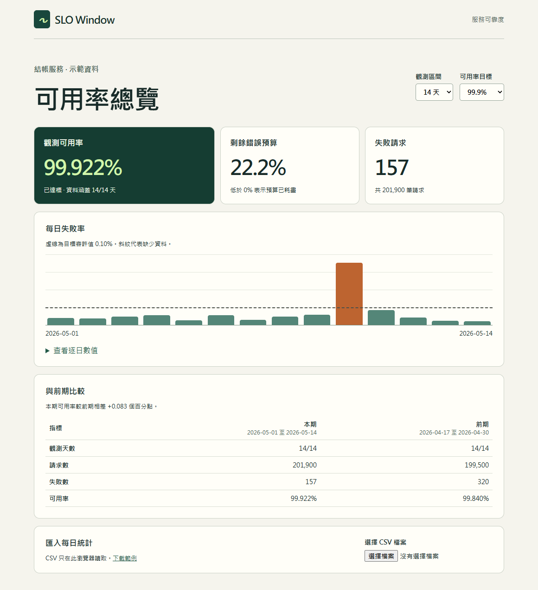

# SLO Window｜服務可靠度儀表板

結帳服務某天的失敗率突然上升，整個觀測區間還符合承諾嗎？上傳每日請求數與失敗數，即可切換時間區間與服務等級目標（SLO），檢視請求加權可用率、剩餘錯誤預算及資料涵蓋率。所有計算在瀏覽器完成。



## 一分鐘操作

使用 Node.js 22.12 以上的 22.x、24.x 或 26.x。

```sh
npm ci
npm run dev
```

開啟終端機顯示的本機網址。預設範例含連續 28 天的資料，選取的本期為最後 14 天，共 201,900 筆請求，其中 157 筆失敗。在 99.9% 的目標下還有 22.2% 錯誤預算。把目標調高到 99.95%，即可看到相同流量下預算轉負。展開「查看逐日數值」可讀取每一天的分子與分母。

在「與前期比較」可以對照 4 月 17–30 日與 5 月 1–14 日。前期有 199,500 筆請求、320 筆失敗，本期流量增加且可用率提高 **0.083 個百分點**。差距以兩期未四捨五入的比率相減後顯示。切換為 7 天或 30 天會同步重算兩個相鄰的 UTC 日期區間。

兩期都有完整觀測，且各自的總請求數大於零時，才顯示可用率差距。如果缺資料，表格仍列出已觀測的請求數與失敗數，可展開清單查看缺少哪幾天。如果整期都缺資料，表格以「—」呈現；如果有紀錄且總請求數為零，請求數顯示 0。

可下載範例，或匯入下列 CSV。日期以 UTC 日為單位，每日一列，請求數包含失敗數。範例檔使用合成資料。

```csv
date,requests,errors
2026-05-01,12000,5
2026-05-02,10500,4
```

## 指標怎麼算

想從逐筆日誌開始展示，可用 [Access Log Rollup](https://github.com/peca12968/access-log-rollup) 將 5 筆跨時區 HTTP 紀錄轉成 CSV，再匯入本頁。結果為 5 筆請求、2 筆服務端失敗、60.000% 可用率，5 月 3 日標示缺資料。GitHub Actions 每次都從指定提交建置該 CLI，將它實際產生的 CSV 交給 Playwright 上傳並核對畫面。

- **觀測可用率**等於 1 − 總失敗數 ÷ 總請求數。按流量加權，避免低流量日扭曲結果。
- **容許失敗數**等於總請求數 ×（1 − 目標可用率）。剩餘預算百分比為（容許失敗數 − 實際失敗數）÷ 容許失敗數 × 100%。
- 區間終點取資料中的最後一天。無資料的日期以斜紋呈現，並列出涵蓋天數。整段零流量時，百分比顯示為「—」。判定達標採用顯示數字四捨五入前的值。
- CSV 會檢查資料列數、日期、重複值與計數邊界。遇到不合法的檔案會顯示錯誤，保留上次成功的報表。

## 工程驗證

```sh
npm test
npm run build
npx playwright install chromium
npm run test:e2e
```

React 與 TypeScript 負責畫面及狀態，[指標計算](src/metrics.ts)可獨立測試。Vitest 檢查流量加權、日期缺口、零流量及異常資料，Playwright 透過實際瀏覽器操作目標選單、上傳兩份 CSV 並核對頁面回饋。GitHub Actions 在推送與 PR 時執行測試及正式版建置。

**履歷用語**　以 React 與 TypeScript 開發 SLO 儀表板，計算請求加權可用率、錯誤預算與跨期差距，以 Vitest 和 Playwright 驗證閏日、缺失觀測、零流量及行動版 CSV 匯入流程。

本專案為使用 AI 輔助建立的作品集示範。
